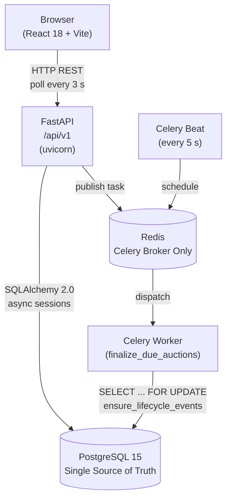
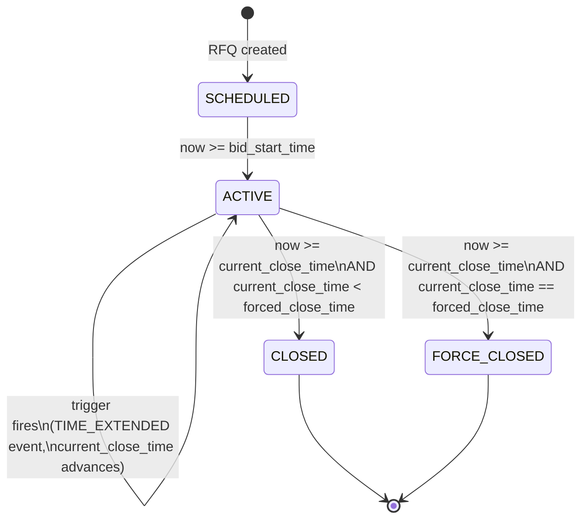

# High-Level Design: NeoBidding — British Auction RFQ System

> Version 0.2 · Phase 0 (rev 1) · 2026-11-14  
> Status: **DRAFT – awaiting Phase 0 approval**

---

## Table of Contents

1. [Problem & Goals](#1-problem--goals)
2. [Functional Requirements Summary](#2-functional-requirements-summary)
3. [Non-Functional Requirements](#3-non-functional-requirements)
4. [Architecture Overview](#4-architecture-overview)
5. [Component Responsibilities](#5-component-responsibilities)
6. [Data Model Summary](#6-data-model-summary)
7. [Auction State Machine](#7-auction-state-machine)
8. [Bid Submission Sequence](#8-bid-submission-sequence)
9. [Extension Algorithm](#9-extension-algorithm-with-time-rule-definitions)
10. [Concurrency & Consistency](#10-concurrency--consistency-strategy)
11. [Idempotency Design](#11-idempotency-design)
12. [Clock & Timezone Handling](#12-clock--timezone-handling)
13. [Status Derivation & Celery Role](#13-status-derivation--celery-role)
14. [Visibility Assumption](#14-visibility-assumption)
15. [Polling vs WebSocket/SSE](#15-polling-vs-websocketsse)
16. [Scalability Notes](#16-scalability-notes-p3)
17. [Failure Modes](#17-failure-modes)
18. [Security Notes](#18-security-notes)
19. [Future Work](#19-future-work)
20. [Alternatives Considered](#20-alternatives-considered-p3)

---

## 1. Problem & Goals

An RFQ (Request for Quotation) system allows a buyer to invite multiple suppliers (carriers) to quote a freight price. In a **British Auction** (reverse auction), suppliers bid openly and compete by lowering prices — the lowest total price wins.

**Core problems to solve:**

| Problem                                         | Solution                                                             |
| ----------------------------------------------- | -------------------------------------------------------------------- |
| Last-second sniping                             | Trigger-window auto-extension                                        |
| Clock skew between client and server            | Server-authoritative `server_time`; client computes offset           |
| Duplicate bid submissions (network retries)     | Idempotency-Key per submission attempt                               |
| Celery downtime leaving auctions in wrong state | Status derived from timestamps; Celery only restores the audit trail |
| Concurrent bids corrupting rank or extension    | Serialized with `SELECT … FOR UPDATE` per RFQ row                    |

**Success metrics surfaced in UI:** bids per RFQ, extensions count, price improvement (first bid → current lowest).

---

## 2. Functional Requirements Summary

| ID  | Requirement                                                               |
| --- | ------------------------------------------------------------------------- |
| F1  | RFQ creation with British / Standard toggle and configuration             |
| F2  | Supplier invitation (multi-select, at least one, Select-All button)       |
| F3  | Quote submission (bid) with server-side total computation                 |
| F4  | Auto-extension when trigger fires inside window (never past forced close) |
| F5  | Bid validation: invited-only, strictly lower, correct state window        |
| F6  | Idempotency for bid POST                                                  |
| F7  | Listing page with status, countdown, live refresh                         |
| F8  | Detail page: supplier ranking + full bid history + activity log           |
| F9  | Activity log with human-readable extension reasons                        |
| F10 | Lifecycle recovery if Celery was offline                                  |

---

## 3. Non-Functional Requirements

| Attribute            | Target                                                                                    |
| -------------------- | ----------------------------------------------------------------------------------------- |
| Correctness          | Auction engine pure-function tested; DB CHECK constraints enforce integrity independently |
| Consistency          | Single-writer-per-RFQ via row lock; PostgreSQL as single source of truth                  |
| Auditability         | Append-only event log with `occurred_at` (logical) vs `created_at` (physical)             |
| Recoverability       | Idempotent lifecycle sweeper; multi-transition catch-up                                   |
| Developer ergonomics | One-command Docker startup; Makefile; FakeClock for deterministic tests                   |
| Coverage             | ≥ 90% on auction engine, bid service, lifecycle service                                   |

---

## 4. Architecture Overview



**Key architectural constraint:** Redis is used _only_ as the Celery message broker. All business data, state, and the audit trail live exclusively in PostgreSQL.

### Layering (strict dependency direction)

```
FastAPI Routes
    └─ bid_service / lifecycle_service  (orchestration, DB, clock)
           └─ auction_engine            (pure functions, no I/O)
                  └─ domain types (Pydantic / dataclasses)
```

No layer may import from a layer above it.

---

## 5. Component Responsibilities

### 5.1 `services/auction_engine.py` (pure, no I/O)

| Function                                                           | Responsibility                                                        |
| ------------------------------------------------------------------ | --------------------------------------------------------------------- |
| `derive_status(rfq, now)`                                          | Returns `AuctionStatus` from timestamps; never reads DB               |
| `assert_transition(from_, to)`                                     | Validates state machine edges; raises if illegal                      |
| `compute_ranking(bids)`                                            | Sorts suppliers by best bid (total asc, submitted_at asc, bid_id asc) |
| `in_trigger_window(rfq, now)`                                      | True if `current_close - X ≤ now < current_close`                     |
| `evaluate_trigger(config, ranking_before, ranking_after, new_bid)` | Returns bool per trigger type                                         |
| `compute_extension(rfq)`                                           | Returns `min(current_close + Y, forced_close)`                        |
| `due_lifecycle_events(rfq, now)`                                   | Returns list of `(event_type, occurred_at)` for unlogged transitions  |

### 5.2 `services/bid_service.py`

Orchestrates the 13-step bid submission algorithm (see §8). Holds the row lock, calls engine functions, writes DB, returns the response.

### 5.3 `services/lifecycle_service.py`

`ensure_lifecycle_events(rfq, now, session)` — idempotent helper called by both bid_service and Celery worker. Uses `INSERT … ON CONFLICT DO NOTHING` on the partial unique index.

### 5.4 Celery tasks

`finalize_due_auctions` — runs every 5 s via beat and once on `worker_ready`. Queries for auctions where `derive_status(rfq, now) != rfq.status` and calls `ensure_lifecycle_events` under a row lock.

### 5.5 FastAPI routes

Thin: parse request → call service → serialize response. No business logic.

---

## 6. Data Model Summary

> Full DDL, column notes, and Mermaid ER diagram are in [SCHEMA.md](./SCHEMA.md).

| Table | Purpose |
|-------|---------|
| `suppliers` | Master list of carriers |
| `rfqs` | Auction configuration and cached status |
| `rfq_suppliers` | Many-to-many invitation list |
| `british_auction_configs` | Extension settings (exists iff auction_type = BRITISH) |
| `bids` | Append-only quote submissions with idempotency fields |
| `auction_events` | Append-only audit log with logical `occurred_at` |

### FK delete policy

Historical tables (`bids`, `auction_events`) use `ON DELETE RESTRICT` on their `rfq_id` and `supplier_id` FKs — a supplier or RFQ cannot be hard-deleted if any bids or events reference them. Config/invitation tables (`british_auction_configs`, `rfq_suppliers`) use `ON DELETE CASCADE` for their `rfq_id` FK — these rows have no independent historical value and should be cleaned up with the RFQ. No hard-delete endpoints are exposed for `suppliers` or `rfqs` in this API.

---

## 7. Auction State Machine

### Valid transitions



**Rules:**

- `CLOSED` and `FORCE_CLOSED` are **terminal** — no further transitions.
- The `ACTIVE → ACTIVE` self-loop is not a true state change; it only updates `current_close_time` and writes a `TIME_EXTENDED` event.
- All other transitions not listed above raise `InvalidTransitionError`.

### Code implementation

```python
ALLOWED_TRANSITIONS = {
    (AuctionStatus.SCHEDULED, AuctionStatus.ACTIVE),
    (AuctionStatus.ACTIVE,    AuctionStatus.CLOSED),
    (AuctionStatus.ACTIVE,    AuctionStatus.FORCE_CLOSED),
}

def assert_transition(from_: AuctionStatus, to: AuctionStatus) -> None:
    if from_ == to:
        return  # no-op (already in target state, idempotent)
    if (from_, to) not in ALLOWED_TRANSITIONS:
        raise InvalidTransitionError(from_, to)
```

---

## 8. Bid Submission Sequence

> **`carrier_name` is derived, not client-supplied.** Step 6 looks up `suppliers.name` for the given `supplier_id` and stores it as a snapshot. This guarantees historical integrity and prevents identity spoofing.

```mermaid
sequenceDiagram
    participant C as Client
    participant R as FastAPI Route
    participant BS as bid_service
    participant AE as auction_engine
    participant DB as PostgreSQL

    C->>R: POST /api/v1/rfqs/{id}/bids\nIdempotency-Key: <uuid>
    R->>BS: submit_bid(rfq_id, payload, idem_key, clock.now())
    BS->>DB: BEGIN; SELECT rfq ... FOR UPDATE
    BS->>BS: idempotency check\n(same key+hash → return snapshot;\ndiff hash → 409)
    BS->>BS: ensure_lifecycle_events(rfq, now)
    BS->>AE: derive_status(rfq, now)
    alt not ACTIVE
        BS-->>C: 409 AUCTION_NOT_STARTED / AUCTION_CLOSED
    end
    BS->>DB: check rfq_suppliers (supplier invited?)
    BS->>DB: SELECT suppliers WHERE id = supplier_id\n→ carrier_name snapshot
    BS->>DB: SELECT bids WHERE rfq_id, supplier_id (best bid)
    BS->>AE: validate (lower than own best, non-negative, etc.)
    BS->>AE: compute_ranking(existing_bids) → ranking_before
    BS->>DB: INSERT bid (submitted_at = clock.now(), carrier_name from snapshot)
    BS->>AE: compute_ranking(all_bids) → ranking_after
    BS->>AE: in_trigger_window(rfq, now)?
    alt in window AND british
        BS->>AE: evaluate_trigger(config, before, after, bid)
        alt triggered
            BS->>AE: compute_extension(rfq) → new_close
            alt new_close > current_close
                BS->>DB: UPDATE rfqs SET current_close_time = new_close
                BS->>DB: INSERT auction_event TIME_EXTENDED\n(occurred_at = clock.now())
            else already at forced cap
                BS->>DB: INSERT auction_event EXTENSION_SKIPPED_AT_FORCED_CLOSE
            end
        end
    end
    BS->>DB: INSERT auction_event BID_PLACED (rank before→after)\n(occurred_at = clock.now())
    BS->>DB: UPDATE bids SET result_snapshot = ...
    BS->>DB: COMMIT
    BS-->>R: BidResult
    R-->>C: 201 BidResponse\n(bid, rank, extended, new_close, server_time)
```

---

## 9. Extension Algorithm with Time-Rule Definitions

### Definitions

| Symbol | Meaning                                           |
| ------ | ------------------------------------------------- |
| `X`    | Trigger window (minutes); integer ≥ 1             |
| `Y`    | Extension duration (minutes); integer ≥ 1         |
| `T_c`  | `current_close_time` (advances on each extension) |
| `T_f`  | `forced_close_time` (immutable)                   |
| `now`  | Server clock captured once at bid receipt         |

### Trigger window

```
in_window = (T_c - X minutes) ≤ now < T_c
```

The left bound is **inclusive**; the right bound is **exclusive** (a bid at exactly `T_c` is already rejected as the auction is closed).

### Trigger evaluation (per type)

| Trigger type                | Fires when                                                                                                                                                                                     |
| --------------------------- | ---------------------------------------------------------------------------------------------------------------------------------------------------------------------------------------------- |
| `BID_IN_LAST_X`             | Any bid accepted while `in_window` is true (always true if in window)                                                                                                                          |
| `ANY_RANK_CHANGE_IN_LAST_X` | The ordered list of `supplier_id`s in `ranking_after` ≠ `ranking_before` (a new supplier entering the ranking counts; a supplier improving price without changing their position does **not**) |
| `L1_CHANGE_IN_LAST_X`       | `ranking_after[0].supplier_id ≠ ranking_before[0].supplier_id` (first ever bid counts since there is no prior L1; L1 improving its own price does **not** trigger)                             |

### Extension computation

```python
new_close = min(current_close_time + timedelta(minutes=Y), forced_close_time)
if new_close > current_close_time:
    UPDATE rfqs SET current_close_time = new_close
    INSERT TIME_EXTENDED event
else:
    INSERT EXTENSION_SKIPPED_AT_FORCED_CLOSE event
```

Extension is added to **`current_close_time`**, not `now`. This prevents shrinking of the remaining window.

### Edge cases

| Scenario                        | Behaviour                                                                                                            |
| ------------------------------- | -------------------------------------------------------------------------------------------------------------------- |
| Bid at exactly `T_c - X`        | In window (inclusive), trigger evaluates                                                                             |
| Bid 1 second before `T_c - X`   | Outside window, no trigger                                                                                           |
| Bid at exactly `T_c`            | Rejected (auction closed)                                                                                            |
| `current_close == forced_close` | `compute_extension` returns `forced_close`; `new_close == current_close`; writes `EXTENSION_SKIPPED_AT_FORCED_CLOSE` |
| Chained extensions              | Each extension re-evaluates from new `T_c`; cap always enforced                                                      |
| `Y` large enough to overshoot   | `min()` clamps to `forced_close`                                                                                     |

---

## 10. Concurrency & Consistency Strategy

### Chosen: Pessimistic row lock (`SELECT … FOR UPDATE`)

```
BEGIN;
SELECT * FROM rfqs WHERE id = $1 FOR UPDATE;  -- blocks concurrent bids on same RFQ
-- all business logic here
COMMIT;
```

**Justification:**

| Option                        | Pros                                           | Cons                                            | Decision                                                         |
| ----------------------------- | ---------------------------------------------- | ----------------------------------------------- | ---------------------------------------------------------------- |
| Pessimistic row lock (chosen) | Simple; no retry logic; correct extension math | Serializes concurrent bids per RFQ              | **Chosen** — bid rates per RFQ are low; correctness > throughput |
| Optimistic (version column)   | No blocking reads                              | Must retry on conflict; extension race possible | Rejected — extension update is not retryable simply              |
| Queue per RFQ                 | Perfectly serialized                           | Complex infra; overkill                         | Rejected for this scope                                          |

The row lock serializes:

1. Two simultaneous bids (only one proceeds; second sees updated `current_close_time`)
2. Two simultaneous sweeper invocations (one wins the lock; both are idempotent)
3. A bid and a sweeper (one proceeds; both use the same idempotent helpers)

---

## 11. Idempotency Design

### Client contract

- The UI generates `crypto.randomUUID()` per submission attempt.
- On network retry of the **same** attempt, the same UUID is reused.
- After a **successful** response, a new UUID is generated for the next bid.

### Server contract

| Scenario | Behaviour |
|---|---|
| Same key, same payload hash | Return `result_snapshot` from stored bid; HTTP 200; header `Idempotent-Replay: true`; no DB insert; no validation re-run (so a retry after close still returns original success) |
| Same key, different payload hash | 409 `IDEMPOTENCY_KEY_CONFLICT` |
| **No key (curl / Swagger)** | **Proceed normally. No retry guarantee: a network retry will create a second bid. The API accepts this for developer ergonomics; the production UI always sends a key.** |
| Concurrent requests with same key | Row lock serializes; second request hits the idempotency lookup and returns stored result |

### Payload identity

```python
canonical = json.dumps({
    "supplier_id": supplier_id,
    "freight_charges": str(Decimal(freight).quantize(Decimal("0.01"))),
    "origin_charges":  str(Decimal(origin).quantize(Decimal("0.01"))),
    "destination_charges": str(Decimal(dest).quantize(Decimal("0.01"))),
    "transit_time_days": transit,
    "quote_validity_days": validity,
}, sort_keys=True)
request_hash = sha256(canonical.encode()).hexdigest()
```

### DB enforcement

```sql
UNIQUE(rfq_id, supplier_id, idempotency_key)
```

A `NULL` key is not constrained (NULL ≠ NULL in SQL).

---

## 12. Clock & Timezone Handling

- All `timestamptz` columns are stored in **UTC**.
- The server exposes `server_time` (ISO 8601 UTC) in every auction response.
- The frontend computes `clockOffset = serverTime - Date.now()` and applies it to countdowns:
  ```js
  const correctedNow = Date.now() + clockOffset;
  ```
- This eliminates client clock skew from countdown displays without requiring NTP.
- The `Clock` dependency in FastAPI is injectable:

  ```python
  class Clock:
      def now(self) -> datetime: return datetime.now(timezone.utc)

  class FakeClock:
      def __init__(self, t: datetime): self._t = t
      def now(self) -> datetime: return self._t
      def advance(self, **kw): self._t += timedelta(**kw)
  ```

- Business logic **never** calls `datetime.now()` directly; it always receives `clock.now()`.

### Application-managed timestamps

The following timestamp columns are **always set explicitly by the application** using `clock.now()`. They carry no `DEFAULT NOW()` clause so that the DB clock can never silently diverge from the application clock (critical for deterministic test assertions with `FakeClock`):

| Column | Table | Why application-managed |
|--------|-------|-------------------------|
| `submitted_at` | `bids` | Must match the `now` captured at step 1 of the bid algorithm |
| `occurred_at` | `auction_events` | Logical event time — may be in the past during recovery |
| `created_at` | `auction_events` | Physical write time — `clock.now()` at insert, not DB time |

Other `created_at` columns on `suppliers`, `rfqs`, and `rfq_suppliers` retain a `DEFAULT NOW()` because they are written only once at creation time, their exact value is not tested by the auction engine, and accepting the DB clock there is safe. The application still passes `clock.now()` explicitly in production code for consistency.

---

## 13. Status Derivation & Celery Role

### Why status is derived (not stored as truth)

```python
def derive_status(rfq, now: datetime) -> AuctionStatus:
    if now < rfq.bid_start_time:
        return AuctionStatus.SCHEDULED
    if now < rfq.current_close_time:
        return AuctionStatus.ACTIVE
    # now >= current_close_time
    if rfq.current_close_time == rfq.forced_close_time:
        return AuctionStatus.FORCE_CLOSED
    return AuctionStatus.CLOSED
```

This pure function returns the **always-correct status** using only timestamps and `now`. Because timestamps are immutable (or monotonically increasing for `current_close_time`), the derived status is correct even if Celery has been down for hours.

The **stored `status` column** is a **cache** — it allows efficient `WHERE status = 'ACTIVE'` queries without scanning timestamps. It is updated by `ensure_lifecycle_events` and must never be used as the authoritative source in business logic.

### Status in API responses

Every API response computes status via a SQL `CASE` expression over the timestamps rather than reading the cached `status` column. This means `GET /rfqs` and `GET /rfqs/{id}` always return the correct derived status even when Celery has not yet updated the cache:

```sql
CASE
  WHEN NOW() < r.bid_start_time       THEN 'SCHEDULED'
  WHEN NOW() < r.current_close_time   THEN 'ACTIVE'
  WHEN r.current_close_time = r.forced_close_time THEN 'FORCE_CLOSED'
  ELSE 'CLOSED'
END AS derived_status
```

The `?status=` filter parameter on `GET /rfqs` applies this same expression in a `WHERE` clause (or `HAVING` / subquery), not `WHERE rfqs.status = $1`. The cached column is used **only** by the Celery sweeper to identify auctions that need their cached status refreshed.

### Celery role

Celery beat (every 5 s) + worker:

1. Query auctions where derived status ≠ cached status.
2. For each, call `ensure_lifecycle_events(rfq, now)` under row lock.
3. This writes any missing lifecycle events with their **logical `occurred_at`** and updates the cached status column.

### Multi-transition recovery example

Scenario: start = 5:00 PM, close = 6:00 PM. Celery offline 4:55–6:10 PM.

| Event             | `occurred_at` | `is_recovered` |
| ----------------- | ------------- | -------------- |
| `AUCTION_STARTED` | 5:00:00 PM    | true           |
| `AUCTION_CLOSED`  | 6:00:00 PM    | true           |

Both events are written at 6:10 PM (physical `created_at`) but carry the correct logical timestamps. The partial unique index + `ON CONFLICT DO NOTHING` ensures idempotency across concurrent sweeper runs.

---

## 14. Visibility Assumption

**Decision:** All data (rankings, amounts, supplier names, full bid history) is visible to any page visitor. There is no authentication.

**Rationale:** The spec explicitly says "no auth" and classifies roles as out-of-scope for this demo.

**In a real system:**

- Buyer sees everything.
- Suppliers see ranking and amounts; supplier name visibility is configurable (e.g. anonymised as "Supplier 1/2/3").
- This would be enforced with JWT middleware and a `roles` claim, adding a `role_visibility` column to `rfq_suppliers`.

This is listed in [§19 Future Work](#19-future-work).

---

## 15. Polling vs WebSocket/SSE

### Current: polling every 3 s

- TanStack Query refetchInterval: 3000 ms.
- Tab-visibility API: polling pauses when tab is hidden.
- Pros: simple, stateless server, works through proxies, easy to reason about.
- Cons: ~3 s lag for real-time events; unnecessary requests when nothing changes.

### Upgrade path to SSE

1. Add a `GET /api/v1/rfqs/{id}/events` endpoint that streams Server-Sent Events.
2. FastAPI supports SSE via `StreamingResponse`.
3. Each lifecycle event and bid writes to a PostgreSQL `NOTIFY` channel; the SSE handler listens with `asyncpg.Connection.add_listener`.
4. Frontend switches from polling to `EventSource`; TanStack Query refetch only on `message` events.
5. No Redis pub/sub needed — PostgreSQL `LISTEN/NOTIFY` is sufficient at this scale.

**WebSocket** would add bidirectional capability (not needed here) and persistent connection state (harder to scale). SSE is the right next step.

---

## 16. Scalability Notes (P3)

| Concern                             | Current approach                    | Scale path                                                      |
| ----------------------------------- | ----------------------------------- | --------------------------------------------------------------- |
| Concurrent bids per RFQ             | Row lock (serialized)               | Queue per RFQ (e.g. Redis list); acceptable up to ~100 bids/min |
| Read load (listing, detail polling) | Direct DB queries                   | Read replicas; add `updated_at` index on `rfqs`                 |
| Celery workers                      | Single worker                       | Horizontal scaling; each worker competes for row locks (safe)   |
| DB size                             | Unbounded append-only bids + events | Partition `bids` and `auction_events` by `rfq_id` or time range |
| API instances                       | Single uvicorn                      | Multiple uvicorn + nginx/haproxy; sessions are stateless        |

---

## 17. Failure Modes

| Failure                                | Impact                                  | Mitigation                                                                                 |
| -------------------------------------- | --------------------------------------- | ------------------------------------------------------------------------------------------ |
| Celery offline                         | Cached status stale; audit log has gaps | Status derived from timestamps (always correct); gaps filled on recovery                   |
| DB connection lost                     | API returns 503                         | SQLAlchemy pool retry; health check endpoint                                               |
| Redis offline                          | Celery tasks not dispatched             | Bid submission unaffected (Celery is non-critical path); sweeper resumes on Redis recovery |
| Clock skew (client)                    | Countdown wrong                         | Server sends `server_time`; client corrects offset                                         |
| Duplicate bid POST (network retry)     | Double-charge, double-extension         | Idempotency-Key prevents double processing                                                 |
| Row lock contention                    | Bid latency spike                       | Acceptable; lock held for <50 ms per bid                                                   |
| Partial commit (crash mid-transaction) | Inconsistent state                      | PostgreSQL atomicity; row-level rollback                                                   |

---

## 18. Security Notes

- No authentication in this demo (explicitly out of scope).
- SQL injection: prevented by SQLAlchemy parameterized queries.
- CORS: restricted to the web origin (`http://localhost:5173` in dev; configurable via env).
- Monetary values: `NUMERIC(14,2)` in DB; `Decimal` in Python; never `float`.
- Idempotency-Key: stored as `VARCHAR(64)`; truncated/rejected if longer than 64 chars.
- Input validation: Pydantic v2 validators + DB CHECK constraints (defence in depth).
- Rate limiting: not implemented; would add `slowapi` middleware for production.
- In production: add JWT auth, HTTPS, secrets management (Vault / GCP Secret Manager).

---

## 19. Future Work

| Item                                           | Notes                                                                                                                                         |
| ---------------------------------------------- | --------------------------------------------------------------------------------------------------------------------------------------------- |
| **Supplier authentication & role-based views** | JWT; supplier sees own bids + anonymised ranking; buyer sees all                                                                              |
| **Minimum bid decrement**                      | Config field `min_decrement` (absolute or %); engine check in step 6                                                                          |
| **Multi-currency conversion**                  | Normalize all bids to a base currency using ECB rate snapshot stored at RFQ creation                                                          |
| **WebSocket / SSE real-time**                  | See §15                                                                                                                                       |
| **Neo4j carrier-lane graph**                   | Model carrier-lane relationships for automatic supplier invitation suggestions; read-only side-car; PostgreSQL remains single source of truth |
| **Audit export**                               | CSV/XLSX download of bid history and event log                                                                                                |
| **Supplier notification emails**               | Celery task sending SMTP/SendGrid when auction opens or they lose L1                                                                          |
| **Rate limiting**                              | `slowapi` with per-IP and per-supplier limits                                                                                                 |
| **Multi-tenancy**                              | `org_id` column on `rfqs` and `suppliers`; row-level security                                                                                 |

---

## 20. Alternatives Considered (P3)

| Decision                | Chosen                      | Rejected                           | Why                                                              |
| ----------------------- | --------------------------- | ---------------------------------- | ---------------------------------------------------------------- |
| Broker                  | Redis                       | RabbitMQ                           | Simpler ops; spec says Redis only                                |
| ORM                     | SQLAlchemy 2.0 async        | Tortoise ORM, Piccolo              | Spec mandates SQLAlchemy 2.0                                     |
| State storage           | PostgreSQL only             | Redis for state caching            | Spec mandates Postgres as single source of truth                 |
| Concurrency             | Pessimistic row lock        | Optimistic (version column), queue | Simplest correct solution; bid rate per RFQ is low               |
| Frontend real-time      | Polling (3 s)               | WebSocket, SSE                     | Simplest; upgrade path documented                                |
| Money type              | `NUMERIC(14,2)` / `Decimal` | `float`                            | Avoids floating-point rounding errors                            |
| Font stack              | Self-hosted via @fontsource | Google Fonts CDN                   | No external CDN dependency; works offline                        |
| Test DB                 | Real Postgres (via Docker)  | SQLite in-memory                   | CHECK constraints and `timestamptz` behave differently in SQLite |
| Container orchestration | Docker Compose / Render PaaS | Kubernetes, Nomad                  | Streamlined production deployments with low operational overhead |
